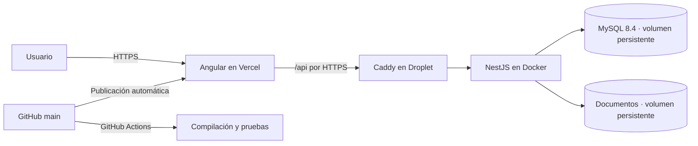

# Arquitectura y estado del entregable

## Componentes desplegados

- **Frontend:** Angular en Vercel. URL pública: <https://aurea-talento-rrhh.vercel.app/>.
- **API:** NestJS en el Droplet de DigitalOcean, detrás de Caddy y HTTPS. El proxy de Vercel dirige `/api/*` a la API.
- **Datos:** MySQL 8.4 y archivos en volúmenes separados de Docker Compose. MySQL no acepta conexiones públicas directas.
- **Código:** <https://github.com/AbmelIng/aurea-talento-rrhh>. `main` contiene la versión presentada; los branches `sprints-1-2`, `sprint-3`, `sprints-4-6`, `sprint-7`, `sprint-8` y `feature/clientes-engagements` conservan hitos anteriores.
- **Verificación:** GitHub Actions compila y prueba API y frontend, migraciones con MySQL y Compose. La publicación de Angular desde `main` es automática; la actualización de la API en el Droplet requiere un paso manual.

## Requisitos y trazabilidad

Las [épicas](requisitos/epicas_sistema_rrhh.md) y el [User Story Mapping](requisitos/UserStoryMapping.md) registran el alcance planteado. Los mapas detallados de EP-02, EP-03, EP-04, EP-05 y EP-10 están en `docs/requisitos/`. Son **documentos de requisitos**, no evidencia de que cada historia esté completa. El detalle de EP-06 faltaba en los materiales originales y se marca como pendiente.

El [README](../README.md) describe lo implementado por sprint y sus límites. El [informe de cambios](../INFORME_CAMBIOS.md), el [informe de sprints 4–6](../INFORME_SPRINTS_4_6.md), la [guía de respaldos](OPERACION_RESPALDOS.md) y el [recorrido de presentación](RECORRIDO_PRESENTACION.md) completan la evidencia técnica.

## Alcance de la demostración

La instalación pública comenzó con un administrador real, sin usuarios ficticios. La demostración de ocho roles utiliza una base SQLite **local y separada** con datos inventados; no se carga al MySQL público. En el Droplet se creó y verificó una copia de MySQL y documentos mediante una restauración aislada. La copia externa al Droplet y una simulación completa de recuperación en otro servidor siguen pendientes.
